# PR-Agent Architecture Explainer

PR-Agent is an open-source, AI-powered code review agent that automates pull request analysis across multiple Git providers. This document explains its architecture, components, and request flow.

## High-Level Architecture

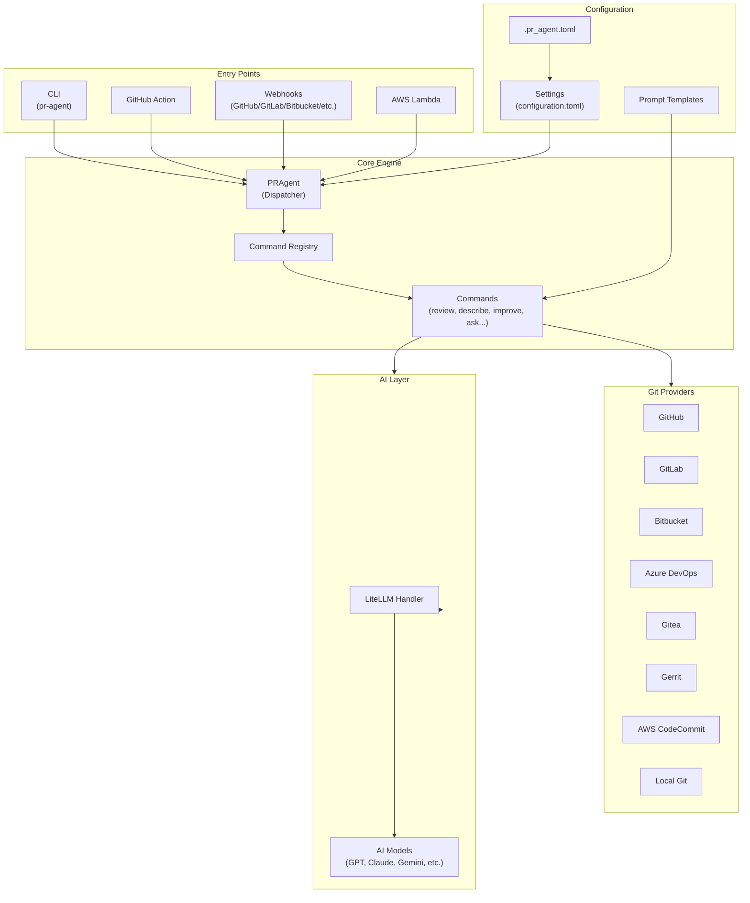

## Component Breakdown

### 1. Entry Points (`pr_agent/servers/`, `pr_agent/cli.py`)

PR-Agent supports multiple deployment modes:

| Entry Point | File | Description |
|-------------|------|-------------|
| CLI | `cli.py` | Local command-line usage |
| GitHub Action | `github_action_runner.py` | CI/CD integration |
| GitHub App | `github_app.py` | Webhook-based GitHub integration |
| GitLab Webhook | `gitlab_webhook.py` | Self-hosted GitLab integration |
| Bitbucket App | `bitbucket_app.py` | Bitbucket Cloud/Server |
| Gitea App | `gitea_app.py` | Gitea webhook handler |
| Gerrit Server | `gerrit_server.py` | Gerrit code review integration |
| AWS Lambda | `github_lambda_webhook.py`, `gitlab_lambda_webhook.py` | Serverless deployment |

### 2. Core Agent (`pr_agent/agent/`)

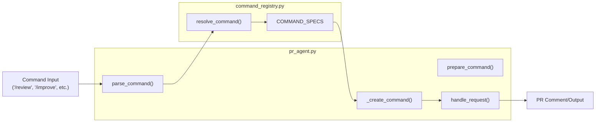

The `PRAgent` class in `pr_agent.py` is the central dispatcher:
- Parses incoming commands (from comments, CLI, or webhooks)
- Resolves command aliases via the registry
- Instantiates the appropriate command class
- Executes the command and handles output

### 3. Command Registry (`pr_agent/agent/command_registry.py`)

The registry maps command names to their implementations:

```python
COMMAND_SPECS = {
    "review": CommandSpec(PRReviewer, check_run="review", ...),
    "describe": CommandSpec(PRDescription, check_run="describe", ...),
    "improve": CommandSpec(PRCodeSuggestions, check_run="suggestions", ...),
    "ask": CommandSpec(PRQuestions, ...),
    # ... more commands
}
```

### 4. Commands (`pr_agent/commands/`)

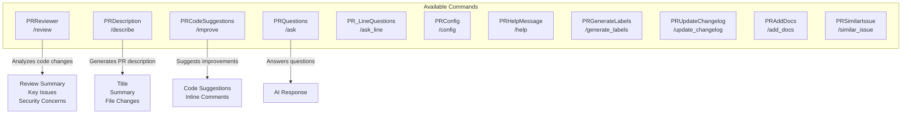

Each command follows a similar pattern:
1. Initialize with PR URL and git provider
2. Fetch PR diff and context
3. Build prompts with diff data
4. Call AI model for analysis
5. Parse response and publish results

### 5. Git Providers (`pr_agent/git_providers/`)

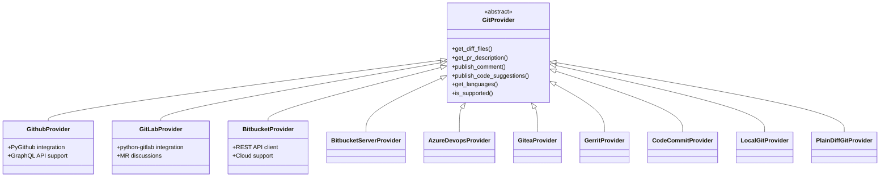

The `GitProvider` abstract base class defines the interface for all provider implementations. Each provider handles:
- Authentication and API access
- Fetching PR/MR metadata and diffs
- Publishing comments and suggestions
- Managing labels and reviews

### 6. AI Handlers (`pr_agent/algo/ai_handlers/`)

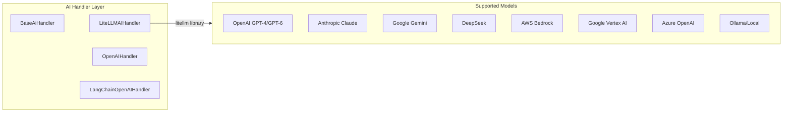

The `LiteLLMAIHandler` is the primary AI handler, using the [LiteLLM](https://github.com/BerriAI/litellm) library to provide a unified interface to 100+ LLM providers.

Key features:
- Automatic retry with fallback models
- Token counting and budget management
- Streaming response support
- Cloud authentication (Azure OIDC, AWS credentials, etc.)

### 7. Algorithm Layer (`pr_agent/algo/`)

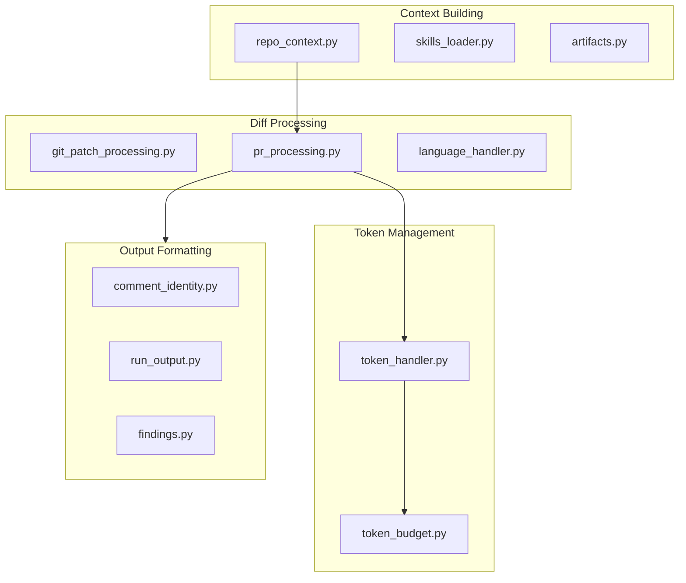

Key algorithm modules:
- **token_handler.py** - Token counting using tiktoken
- **token_budget.py** - Managing prompt/response token limits
- **pr_processing.py** - PR diff preparation and chunking
- **repo_context.py** - Loading repository context files (AGENTS.md, etc.)
- **review_merge.py** - Merging chunked review results

## Request Flow

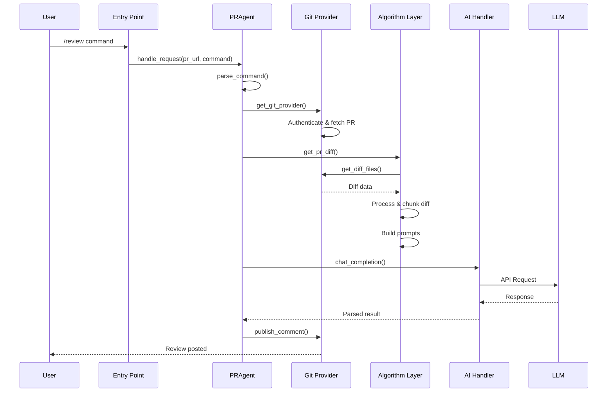

## Configuration System

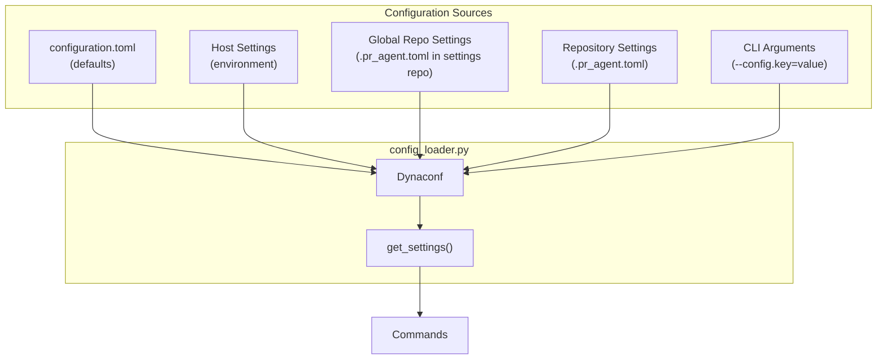

Configuration precedence (lowest to highest):
1. Default `configuration.toml`
2. Host-level environment variables
3. Global organization settings repo
4. Repository-level `.pr_agent.toml`
5. CLI arguments / comment commands

## Prompt System

PR-Agent uses a template-based prompt system with Jinja2 rendering. Here's how prompts are built:

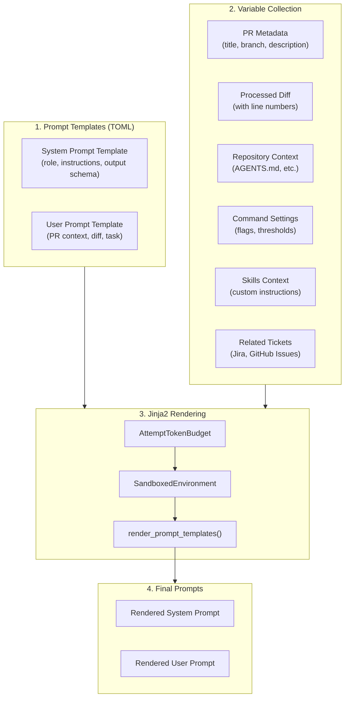

### Step 1: Load Prompt Templates

Prompts are defined in TOML files under `pr_agent/settings/`. Example from `pr_reviewer_prompts.toml`:

```toml
[pr_review_prompt]
system="""You are PR-Reviewer, a language model designed to review a Git Pull Request (PR).
Your task is to provide constructive and concise feedback for the PR.
...

Repository context:
======
{{ repo_context }}
======

...
"""

user="""PR Info:
Title: '{{ title }}'
Branch: '{{ branch }}'
Description: '{{ description }}'
...
The PR Diff:
======
{{ diff }}
======
...
"""
```

### Step 2: Collect Variables

Each command builds a `self.vars` dictionary with all data needed for the prompt:

```python
# From pr_reviewer.py __init__
self.vars = {
    "title": self.git_provider.pr.title,
    "branch": self.git_provider.get_pr_branch(),
    "description": self.pr_description,
    "language": self.main_language,
    "diff": "",  # filled later after token budgeting
    "num_max_findings": get_settings().pr_reviewer.num_max_findings,
    "require_score": get_settings().pr_reviewer.require_score_review,
    "extra_instructions": get_settings().pr_reviewer.extra_instructions,
    "repo_context": build_repo_context(self.git_provider),
    "skills_context": get_skills_context(),
    "related_tickets": get_settings().get('related_tickets', []),
    # ... more variables
}
```

### Step 3: Token Budgeting and Diff Fitting

Before rendering, the algorithm layer ensures the diff fits within token limits:

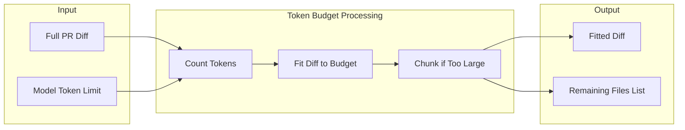

The `AttemptTokenBudget` class manages this:
- Calculates available tokens after system prompt overhead
- Fits the diff to the remaining budget
- Tracks files that couldn't fit (reported as "additional modified files")

### Step 4: Render with Jinja2

The `render_prompt_templates()` method renders the final prompts:

```python
# From token_budget.py
def render_prompt_templates(self, variables: dict) -> tuple[str, str]:
    """Render this attempt handler's templates with the supplied variables."""
    environment = SandboxedEnvironment(undefined=StrictUndefined)
    system_prompt = environment.from_string(self.token_handler.system).render(variables)
    user_prompt = environment.from_string(self.token_handler.user).render(variables)
    return system_prompt, user_prompt
```

Key features:
- **SandboxedEnvironment** — Prevents code execution in templates
- **StrictUndefined** — Fails fast if a variable is missing
- **Conditional sections** — `...` includes content only when present

### Step 5: Prepare and Send Request

After rendering, the prompts are packaged into an API request:

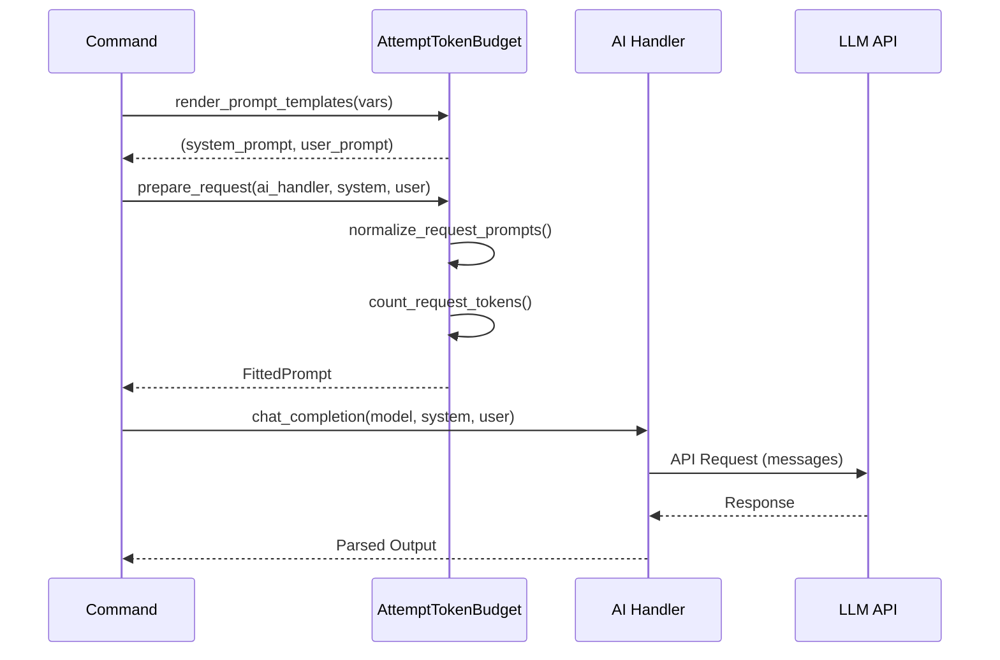

### Variable Sources Summary

| Variable | Source | Example |
|----------|--------|---------|
| `title` | Git Provider | "Fix null pointer in auth module" |
| `diff` | `pr_processing.py` | Unified diff with line numbers |
| `repo_context` | `repo_context.py` | Contents of AGENTS.md |
| `skills_context` | `skills_loader.py` | Custom review instructions |
| `related_tickets` | `ticket_pr_compliance_check.py` | Jira/GitHub issue content |
| `extra_instructions` | Configuration | User-defined review focus |
| `require_*` | Settings | Feature flags for output sections |

## Data Flow Summary

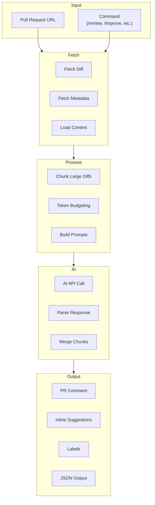

## Key Design Patterns

1. **Provider Abstraction** - All Git platforms implement the same interface
2. **Command Pattern** - Each command is a self-contained class
3. **Fallback Chain** - Automatic retry with weaker models on failure
4. **Chunked Processing** - Large PRs are split into manageable pieces
5. **Token Budget Management** - Precise control over prompt sizes
6. **Configuration Layering** - Hierarchical settings with clear precedence
7. **Identity Markers** - Comments carry hidden markers for deduplication

## File Structure Overview

```
pr_agent/
├── agent/                  # Core dispatcher
│   ├── pr_agent.py        # Main PRAgent class
│   └── command_registry.py # Command mapping
├── commands/              # Command implementations
│   ├── pr_reviewer.py
│   ├── pr_description.py
│   ├── pr_code_suggestions.py
│   └── ...
├── git_providers/         # Git platform integrations
│   ├── github_provider.py
│   ├── gitlab_provider.py
│   └── ...
├── algo/                  # Core algorithms
│   ├── ai_handlers/       # AI model integrations
│   ├── token_handler.py
│   ├── pr_processing.py
│   └── ...
├── servers/               # Webhook servers
│   ├── github_app.py
│   ├── gitlab_webhook.py
│   └── ...
├── settings/              # Configuration & prompts
│   ├── configuration.toml
│   ├── pr_reviewer_prompts.toml
│   └── ...
└── cli.py                 # CLI entry point
```

## FAQ

### Can I use Claude Code or Kiro CLI instead of an API key?

**Short answer:** Not directly. These are interactive terminal agents, not API endpoints.

**Why not?** PR-Agent expects an HTTP API that accepts JSON requests and returns structured responses. Claude Code/Kiro CLI are designed for human-in-the-loop usage with their own session state and tool management.

**Workaround:** Create a local proxy server that wraps the CLI's non-interactive mode:

```python
# claude_proxy.py
from fastapi import FastAPI
from pydantic import BaseModel
import subprocess, json

app = FastAPI()

class ChatRequest(BaseModel):
    messages: list

@app.post("/v1/chat/completions")
async def chat(request: ChatRequest):
    prompt = "\n".join(f"{m['role']}: {m['content']}" for m in request.messages)
    result = subprocess.run(
        ["claude", "-p", prompt, "--output-format", "json"],
        capture_output=True, text=True, timeout=300
    )
    response = json.loads(result.stdout)
    return {
        "choices": [{"message": {"content": response.get("result", "")}}],
        "usage": {"prompt_tokens": 0, "completion_tokens": 0}
    }
```

Then configure PR-Agent to use it:
```toml
[config]
model = "openai/claude-proxy"

[openai]
api_base = "http://localhost:8000/v1"
key = "dummy"
```

**Alternatives without separate API keys:**
- **AWS Bedrock** — Use Claude via existing AWS credentials
- **Google Vertex AI** — Use Claude via existing GCP credentials
- **Ollama** — Run open-source models locally (requires GPU)

## Further Reading

- [Installation Guide](../installation/github.md)
- [Configuration Options](../usage-guide/configuration_options.md)
- [Changing a Model](../usage-guide/changing_a_model.md)
- [Contributing Guidelines](https://github.com/The-PR-Agent/pr-agent/blob/main/CONTRIBUTING.md)
