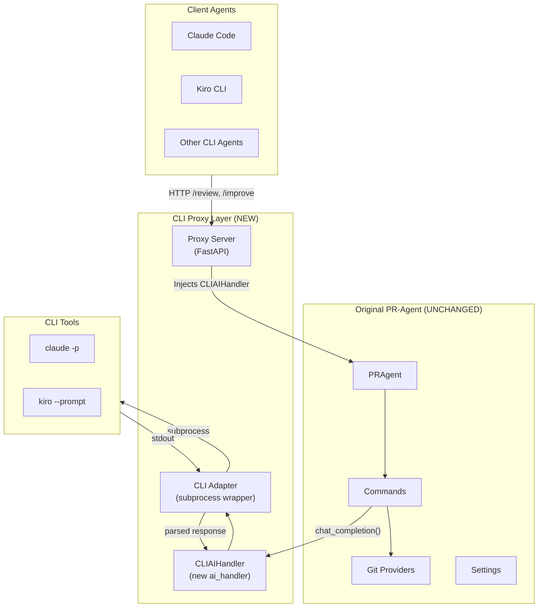

# Implementation Plan: CLI Proxy Server for PR-Agent

## Overview

Create a proxy server that allows Claude Code, Kiro CLI, or other CLI-based AI agents to use PR-Agent's code review capabilities without requiring a separate LLM API key.

### Key Principle
**The original PR-Agent endpoints and AI handlers remain unchanged.** The proxy intercepts AI calls and routes them through a CLI subprocess instead of HTTP APIs.

## Architecture



## Design Goals

1. **Zero changes to core PR-Agent** — Original AI handlers, commands, and providers untouched
2. **Pluggable CLI adapters** — Support multiple CLI tools (Claude Code, Kiro, custom)
3. **Configuration-driven** — Select CLI tool via environment or config
4. **Graceful degradation** — Clear errors when CLI tool unavailable
5. **Testable** — Mock CLI responses for unit tests

## Implementation Components

### 1. CLI AI Handler (`pr_agent/algo/ai_handlers/cli_ai_handler.py`)

A new `BaseAiHandler` implementation that routes to CLI tools instead of HTTP APIs.

```python
# pr_agent/algo/ai_handlers/cli_ai_handler.py
"""AI handler that routes completions through CLI tools (Claude Code, Kiro, etc.)."""

import asyncio
import json
import shutil
from abc import ABC, abstractmethod

from pr_agent.algo.ai_handlers.base_ai_handler import BaseAiHandler
from pr_agent.config_loader import get_settings
from pr_agent.log import get_logger


class CLIAdapter(ABC):
    """Abstract adapter for CLI-based AI tools."""
    
    @property
    @abstractmethod
    def name(self) -> str:
        """Human-readable name for logging."""
        pass
    
    @property
    @abstractmethod
    def executable(self) -> str:
        """CLI executable name."""
        pass
    
    @abstractmethod
    def build_command(self, prompt: str) -> list[str]:
        """Build the subprocess command."""
        pass
    
    @abstractmethod
    def parse_response(self, stdout: str, stderr: str) -> str:
        """Parse CLI output to extract the response text."""
        pass
    
    def is_available(self) -> bool:
        """Check if the CLI tool is installed and accessible."""
        return shutil.which(self.executable) is not None


class ClaudeCodeAdapter(CLIAdapter):
    """Adapter for Claude Code CLI (claude -p)."""
    
    @property
    def name(self) -> str:
        return "Claude Code"
    
    @property
    def executable(self) -> str:
        return "claude"
    
    def build_command(self, prompt: str) -> list[str]:
        return [
            "claude",
            "-p", prompt,
            "--output-format", "json",
            "--no-input",  # Non-interactive mode
        ]
    
    def parse_response(self, stdout: str, stderr: str) -> str:
        try:
            data = json.loads(stdout)
            return data.get("result", data.get("response", stdout))
        except json.JSONDecodeError:
            # Fallback: return raw output
            return stdout.strip()


class KiroCLIAdapter(CLIAdapter):
    """Adapter for Kiro CLI."""
    
    @property
    def name(self) -> str:
        return "Kiro CLI"
    
    @property
    def executable(self) -> str:
        return "kiro"
    
    def build_command(self, prompt: str) -> list[str]:
        # Adjust based on actual Kiro CLI interface
        return [
            "kiro",
            "chat",
            "--prompt", prompt,
            "--no-interactive",
            "--output", "json",
        ]
    
    def parse_response(self, stdout: str, stderr: str) -> str:
        try:
            data = json.loads(stdout)
            return data.get("response", data.get("content", stdout))
        except json.JSONDecodeError:
            return stdout.strip()


# Registry of available adapters
CLI_ADAPTERS: dict[str, type[CLIAdapter]] = {
    "claude": ClaudeCodeAdapter,
    "claude-code": ClaudeCodeAdapter,
    "kiro": KiroCLIAdapter,
    "kiro-cli": KiroCLIAdapter,
}


class CLIAIHandler(BaseAiHandler):
    """AI handler that delegates to CLI tools instead of HTTP APIs."""
    
    def __init__(self, adapter: CLIAdapter | None = None):
        super().__init__()
        self.adapter = adapter or self._get_configured_adapter()
        if not self.adapter.is_available():
            raise RuntimeError(
                f"{self.adapter.name} CLI not found. "
                f"Ensure '{self.adapter.executable}' is installed and in PATH."
            )
        get_logger().info(f"CLIAIHandler initialized with {self.adapter.name}")
    
    def _get_configured_adapter(self) -> CLIAdapter:
        """Get adapter from configuration."""
        cli_tool = get_settings().get("CLI_PROXY.TOOL", "claude")
        adapter_class = CLI_ADAPTERS.get(cli_tool.lower())
        if not adapter_class:
            raise ValueError(
                f"Unknown CLI tool: {cli_tool}. "
                f"Available: {', '.join(CLI_ADAPTERS.keys())}"
            )
        return adapter_class()
    
    @property
    def deployment_id(self) -> str:
        return f"cli-proxy/{self.adapter.name.lower().replace(' ', '-')}"
    
    async def chat_completion(
        self,
        model: str,
        system: str,
        user: str,
        temperature: float = 0.2,
        img_path: str = None,
    ) -> tuple[str, dict]:
        """Execute completion via CLI subprocess."""
        if img_path:
            get_logger().warning(
                f"{self.adapter.name} CLI proxy does not support image inputs; ignoring img_path"
            )
        
        # Combine system and user prompts
        full_prompt = f"{system}\n\n---\n\n{user}"
        
        # Build and execute command
        cmd = self.adapter.build_command(full_prompt)
        get_logger().debug(f"Executing CLI command: {cmd[0]} ...")
        
        timeout = get_settings().get("CLI_PROXY.TIMEOUT", 300)  # 5 min default
        
        try:
            proc = await asyncio.create_subprocess_exec(
                *cmd,
                stdout=asyncio.subprocess.PIPE,
                stderr=asyncio.subprocess.PIPE,
            )
            stdout, stderr = await asyncio.wait_for(
                proc.communicate(),
                timeout=timeout,
            )
        except asyncio.TimeoutError:
            proc.kill()
            raise TimeoutError(
                f"{self.adapter.name} CLI timed out after {timeout}s"
            )
        except FileNotFoundError:
            raise RuntimeError(
                f"{self.adapter.name} CLI not found: {self.adapter.executable}"
            )
        
        stdout_str = stdout.decode("utf-8", errors="replace")
        stderr_str = stderr.decode("utf-8", errors="replace")
        
        if proc.returncode != 0:
            get_logger().error(
                f"{self.adapter.name} CLI failed",
                returncode=proc.returncode,
                stderr=stderr_str[:500],
            )
            raise RuntimeError(
                f"{self.adapter.name} CLI exited with code {proc.returncode}: "
                f"{stderr_str[:200]}"
            )
        
        response = self.adapter.parse_response(stdout_str, stderr_str)
        
        # Return (response, usage_stats) — usage unknown for CLI tools
        usage = {
            "prompt_tokens": 0,
            "completion_tokens": 0,
            "total_tokens": 0,
        }
        
        get_logger().info(
            f"{self.adapter.name} CLI completed",
            response_length=len(response),
        )
        
        return response, usage
```

### 2. Proxy Server (`pr_agent/servers/cli_proxy_server.py`)

A lightweight FastAPI server that wraps PR-Agent with the CLI handler.

```python
# pr_agent/servers/cli_proxy_server.py
"""Proxy server that uses CLI tools (Claude Code, Kiro) as the AI backend."""

import copy
import os

import uvicorn
from fastapi import FastAPI, HTTPException, Request
from pydantic import BaseModel
from starlette.middleware import Middleware
from starlette_context import context
from starlette_context.middleware import RawContextMiddleware

from pr_agent.agent.pr_agent import PRAgent
from pr_agent.algo.ai_handlers.cli_ai_handler import CLIAIHandler
from pr_agent.config_loader import get_settings, global_settings
from pr_agent.git_providers.utils import apply_repo_settings
from pr_agent.log import LoggingFormat, get_logger, setup_logger
from pr_agent.servers.request_body_limit import get_max_request_body_size

setup_logger(fmt=LoggingFormat.JSON, level=os.getenv("LOG_LEVEL", "INFO"))

app = FastAPI(
    title="PR-Agent CLI Proxy",
    description="PR-Agent with CLI-based AI backend (Claude Code, Kiro, etc.)",
    version="1.0.0",
)


class ReviewRequest(BaseModel):
    pr_url: str
    command: str = "review"
    args: list[str] = []


class ReviewResponse(BaseModel):
    success: bool
    command: str
    pr_url: str
    message: str | None = None
    error: str | None = None


@app.get("/health")
async def health():
    """Health check endpoint."""
    try:
        handler = CLIAIHandler()
        return {
            "status": "healthy",
            "cli_tool": handler.adapter.name,
            "cli_available": handler.adapter.is_available(),
        }
    except Exception as e:
        return {
            "status": "degraded",
            "error": str(e),
        }


@app.post("/api/v1/review", response_model=ReviewResponse)
async def review(request: ReviewRequest):
    """Run /review command on a PR."""
    return await _run_command(request.pr_url, "review", request.args)


@app.post("/api/v1/describe", response_model=ReviewResponse)
async def describe(request: ReviewRequest):
    """Run /describe command on a PR."""
    return await _run_command(request.pr_url, "describe", request.args)


@app.post("/api/v1/improve", response_model=ReviewResponse)
async def improve(request: ReviewRequest):
    """Run /improve command on a PR."""
    return await _run_command(request.pr_url, "improve", request.args)


@app.post("/api/v1/ask", response_model=ReviewResponse)
async def ask(request: ReviewRequest):
    """Run /ask command on a PR."""
    return await _run_command(request.pr_url, "ask", request.args)


@app.post("/api/v1/command", response_model=ReviewResponse)
async def generic_command(request: ReviewRequest):
    """Run any PR-Agent command."""
    return await _run_command(request.pr_url, request.command, request.args)


async def _run_command(pr_url: str, command: str, args: list[str]) -> ReviewResponse:
    """Execute a PR-Agent command with CLI AI handler."""
    get_logger().info(f"CLI Proxy: {command} on {pr_url}")
    
    try:
        # Initialize CLI handler
        ai_handler = CLIAIHandler
        
        # Create PR-Agent with CLI handler injected
        agent = PRAgent(ai_handler=ai_handler)
        
        # Apply repo settings if available
        try:
            await apply_repo_settings(pr_url)
        except Exception as e:
            get_logger().warning(f"Could not apply repo settings: {e}")
        
        # Run the command
        result = await agent.handle_request(pr_url, f"/{command} " + " ".join(args))
        
        if result:
            return ReviewResponse(
                success=True,
                command=command,
                pr_url=pr_url,
                message=f"Command /{command} completed successfully",
            )
        else:
            return ReviewResponse(
                success=False,
                command=command,
                pr_url=pr_url,
                error="Command returned False (check PR-Agent logs)",
            )
    
    except Exception as e:
        get_logger().exception(f"CLI Proxy command failed: {e}")
        return ReviewResponse(
            success=False,
            command=command,
            pr_url=pr_url,
            error=str(e),
        )


def start():
    """Start the CLI proxy server."""
    host = os.getenv("HOST", "0.0.0.0")
    port = int(os.getenv("PORT", "8080"))
    get_logger().info(f"Starting PR-Agent CLI Proxy on {host}:{port}")
    uvicorn.run(app, host=host, port=port)


if __name__ == "__main__":
    start()
```

### 3. Configuration Schema (`pr_agent/settings/configuration.toml` additions)

```toml
# Add to configuration.toml

[cli_proxy]
# CLI tool to use: "claude", "claude-code", "kiro", "kiro-cli"
tool = "claude"
# Timeout in seconds for CLI command execution
timeout = 300
# Enable verbose CLI output logging
verbose = false
# Path to CLI executable (if not in PATH)
executable_path = ""
```

### 4. Handler Factory Update

Modify how commands select their AI handler to support CLI proxy mode.

```python
# pr_agent/algo/ai_handlers/__init__.py (new file or update existing)

from pr_agent.config_loader import get_settings

def get_ai_handler():
    """Factory function to get the appropriate AI handler."""
    if get_settings().get("CLI_PROXY.ENABLED", False):
        from pr_agent.algo.ai_handlers.cli_ai_handler import CLIAIHandler
        return CLIAIHandler
    else:
        from pr_agent.algo.ai_handlers.litellm_ai_handler import LiteLLMAIHandler
        return LiteLLMAIHandler
```

### 5. Docker Support (`docker/Dockerfile.cli_proxy`)

```dockerfile
# docker/Dockerfile.cli_proxy
FROM python:3.12-slim

WORKDIR /app

# Install PR-Agent
COPY . .
RUN pip install -e ".[github,gitlab]"

# Note: Claude Code / Kiro CLI must be mounted or installed separately
# Example: mount -v ~/.claude:/root/.claude for auth

ENV CLI_PROXY_ENABLED=true
ENV CLI_PROXY_TOOL=claude
ENV PORT=8080

EXPOSE 8080

CMD ["python", "-m", "pr_agent.servers.cli_proxy_server"]
```

## File Structure

```
pr_agent/
├── algo/
│   └── ai_handlers/
│       ├── __init__.py          # Add get_ai_handler() factory
│       ├── base_ai_handler.py   # UNCHANGED
│       ├── litellm_ai_handler.py # UNCHANGED
│       ├── cli_ai_handler.py    # NEW: CLI adapter and handler
│       └── cli_adapters/        # NEW: Per-tool adapters
│           ├── __init__.py
│           ├── base.py
│           ├── claude_code.py
│           └── kiro_cli.py
├── servers/
│   ├── github_app.py            # UNCHANGED
│   ├── gitlab_webhook.py        # UNCHANGED
│   └── cli_proxy_server.py      # NEW: Proxy server
├── settings/
│   └── configuration.toml       # ADD: [cli_proxy] section
└── ...
```

## Implementation Phases

### Phase 1: Core CLI Handler (2-3 days)
1. Create `CLIAdapter` base class and interface
2. Implement `ClaudeCodeAdapter` for Claude Code
3. Implement `CLIAIHandler` extending `BaseAiHandler`
4. Add unit tests with mocked subprocess

### Phase 2: Proxy Server (1-2 days)
1. Create FastAPI proxy server
2. Add endpoints for `/review`, `/describe`, `/improve`, `/ask`
3. Add health check endpoint
4. Add request/response logging

### Phase 3: Kiro CLI Support (1 day)
1. Implement `KiroCLIAdapter`
2. Test with actual Kiro CLI
3. Document Kiro-specific configuration

### Phase 4: Configuration & Documentation (1 day)
1. Add `[cli_proxy]` section to configuration.toml
2. Update architecture documentation
3. Add setup guide for CLI proxy mode
4. Add troubleshooting section

### Phase 5: Docker & CI (1 day)
1. Create Dockerfile for CLI proxy
2. Add CI workflow for CLI proxy tests
3. Document container deployment with CLI tools

## Usage Examples

### Starting the Proxy Server

```bash
# With Claude Code
export CLI_PROXY_TOOL=claude
python -m pr_agent.servers.cli_proxy_server

# With Kiro CLI
export CLI_PROXY_TOOL=kiro
python -m pr_agent.servers.cli_proxy_server
```

### Calling from Claude Code / Kiro CLI

```bash
# Using the proxy from Claude Code
claude -p "Review this PR: curl -X POST http://localhost:8080/api/v1/review \
  -H 'Content-Type: application/json' \
  -d '{\"pr_url\": \"https://github.com/owner/repo/pull/123\"}'"

# Or directly via curl
curl -X POST http://localhost:8080/api/v1/review \
  -H "Content-Type: application/json" \
  -d '{"pr_url": "https://github.com/owner/repo/pull/123"}'
```

### Using as MCP Tool

The proxy can be exposed as an MCP tool for Claude Code:

```json
{
  "name": "pr_agent_review",
  "description": "Review a GitHub/GitLab pull request",
  "input_schema": {
    "type": "object",
    "properties": {
      "pr_url": {"type": "string", "description": "URL of the PR to review"}
    },
    "required": ["pr_url"]
  }
}
```

## Testing Strategy

### Unit Tests
```python
# tests/unittest/test_cli_ai_handler.py

import pytest
from unittest.mock import AsyncMock, patch

from pr_agent.algo.ai_handlers.cli_ai_handler import (
    CLIAIHandler,
    ClaudeCodeAdapter,
)


@pytest.fixture
def mock_adapter():
    adapter = ClaudeCodeAdapter()
    return adapter


@patch("asyncio.create_subprocess_exec")
async def test_chat_completion_success(mock_exec, mock_adapter):
    mock_proc = AsyncMock()
    mock_proc.communicate.return_value = (
        b'{"result": "Test response"}',
        b"",
    )
    mock_proc.returncode = 0
    mock_exec.return_value = mock_proc
    
    with patch.object(mock_adapter, "is_available", return_value=True):
        handler = CLIAIHandler(adapter=mock_adapter)
        response, usage = await handler.chat_completion(
            model="ignored",
            system="You are a reviewer",
            user="Review this code",
        )
    
    assert response == "Test response"
    assert usage["total_tokens"] == 0


async def test_cli_not_available():
    adapter = ClaudeCodeAdapter()
    with patch.object(adapter, "is_available", return_value=False):
        with pytest.raises(RuntimeError, match="CLI not found"):
            CLIAIHandler(adapter=adapter)
```

### Integration Tests
```python
# tests/e2e_tests/test_cli_proxy_server.py

import pytest
from fastapi.testclient import TestClient

from pr_agent.servers.cli_proxy_server import app


@pytest.fixture
def client():
    return TestClient(app)


def test_health_check(client):
    response = client.get("/health")
    assert response.status_code == 200
    assert "status" in response.json()


@pytest.mark.skip(reason="Requires actual CLI tool")
def test_review_command(client):
    response = client.post(
        "/api/v1/review",
        json={"pr_url": "https://github.com/test/repo/pull/1"},
    )
    assert response.status_code == 200
```

## Security Considerations

1. **No API keys stored** — CLI tools use their own auth mechanisms
2. **Subprocess isolation** — Commands run in separate processes
3. **Input sanitization** — Escape shell-sensitive characters in prompts
4. **Timeout enforcement** — Prevent runaway CLI processes
5. **No credential passthrough** — Git provider tokens handled separately

## Limitations

1. **No streaming** — CLI output is collected after completion
2. **No token counting** — CLI tools don't report usage
3. **Single model** — No fallback chain (CLI tool decides model)
4. **No image support** — Most CLI tools don't accept images
5. **Auth dependency** — Requires CLI tool to be pre-authenticated

## Future Enhancements

1. **MCP Server mode** — Expose as native MCP tool for Claude Code
2. **Streaming support** — Parse incremental CLI output if available
3. **Multiple CLI fallback** — Try Kiro if Claude fails
4. **Response caching** — Cache identical prompts for cost savings
5. **Prompt optimization** — Compress prompts for CLI context limits
